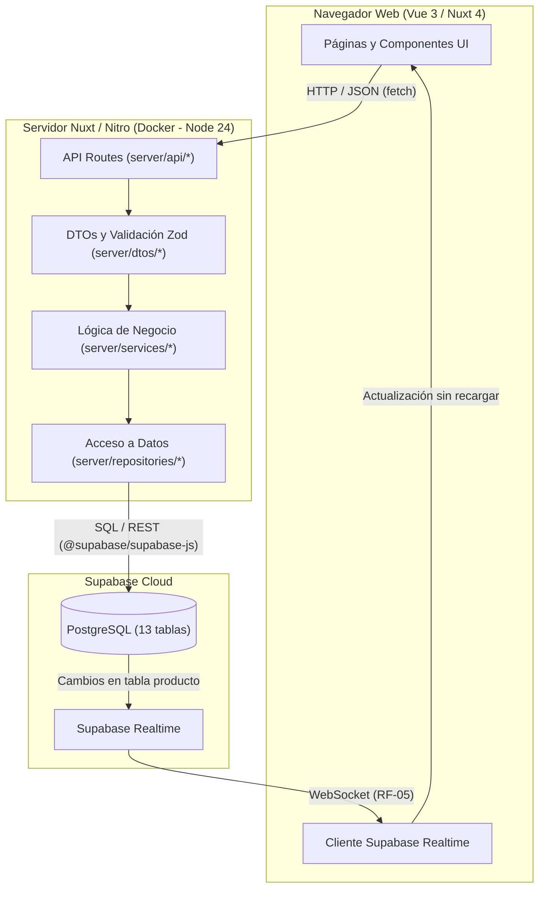
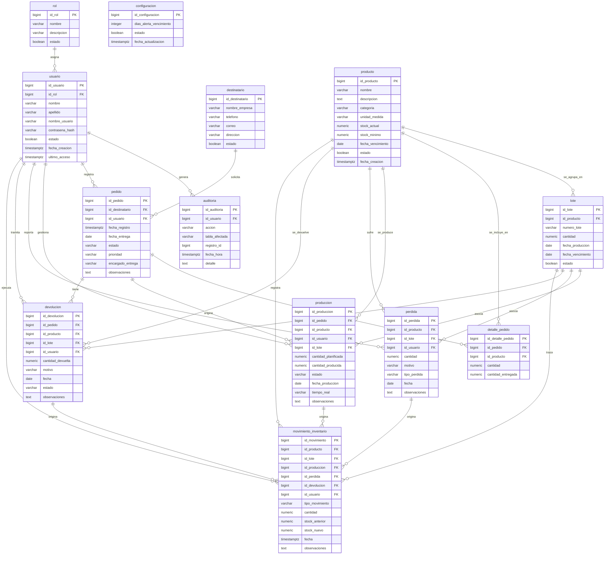
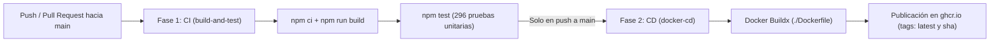

# Sistema de Gestión de Inventario (SGI) — Panadería La Nueva Victoria

Sistema web para la gestión integral del inventario, pedidos, producción, mermas, devoluciones, alertas de vencimiento y reportes de la **Panadería La Nueva Victoria**.

---

## Tabla de contenidos

1. [Tecnologías utilizadas](#tecnologías-utilizadas)
2. [Módulos y rutas de la aplicación](#módulos-y-rutas-de-la-aplicación)
3. [Arquitectura del sistema](#arquitectura-del-sistema)
4. [Estructura del proyecto](#estructura-del-proyecto)
5. [Base de datos y Diagrama Entidad-Relación (DER)](#base-de-datos-y-diagrama-entidad-relación-der)
6. [Catálogo de endpoints API](#catálogo-de-endpoints-api)
7. [Variables de entorno](#variables-de-entorno)
8. [Instalación y ejecución local](#instalación-y-ejecución-local)
9. [Ejecución con Docker](#ejecución-con-docker)
10. [Pruebas automatizadas](#pruebas-automatizadas)
11. [Pipeline de CI/CD (GitHub Actions)](#pipeline-de-cicd-github-actions)
12. [Reparto de Sprints y documentación Scrum / QA](#reparto-de-sprints-y-documentación-scrum--qa)
13. [Flujo de trabajo con Git](#flujo-de-trabajo-con-git)

---

## Tecnologías utilizadas

| Capa | Tecnología |
| --- | --- |
| Framework Full-Stack | Nuxt 4 (`^4.5.2`) + Nitro |
| Frontend | Vue 3 (`^3.5.42`), TypeScript, Tailwind CSS, Pinia |
| Validación | Zod (`^4.6.5`) |
| Base de datos y Realtime | Supabase (PostgreSQL + Realtime WebSockets) |
| Autenticación / Hash | `bcryptjs` |
| Pruebas unitarias e integración | Vitest (`^5.0.3`), `@nuxt/test-utils`, `happy-dom` |
| Pruebas E2E | Playwright (`@playwright/test`) sobre Google Chrome |
| Contenedores | Docker (multi-stage `node:24-slim`) y Docker Compose |
| CI/CD | GitHub Actions + GitHub Container Registry (`ghcr.io`) |

---

## Módulos y rutas de la aplicación

| Ruta | Módulo | Requerimientos cubiertos |
| --- | --- | --- |
| `/login` | Inicio de sesión de administrador | RF-15 |
| `/` | Redirección inteligente (`/productos` con sesión, `/login` sin sesión) | RF-15 |
| `/productos` | Gestión de productos, vencimientos, alertas, búsqueda avanzada y Realtime | RF-01, RF-03, RF-04, RF-05, RF-06, RF-07 |
| `/destinatarios` | Registro y consulta de destinatarios / clientes | RF-12 |
| `/pedidos` | Registro, seguimiento y finalización de pedidos | RF-02, RF-21 |
| `/produccion` | Cola de producción en tiempo real y actualización de estados | RF-20 |
| `/perdidas` | Registro de pérdidas / mermas con ajuste automático de stock | RF-09 |
| `/devoluciones` | Gestión de devoluciones sobre pedidos elegibles | RF-11 |
| `/reportes` | Reporte filtrable de movimientos de inventario y exportación CSV | RF-08 |

---

## Arquitectura del sistema

El proyecto implementa una **arquitectura por capas** sobre Nuxt 4 (Frontend Vue + Backend Nitro) conectada a Supabase (PostgreSQL y Realtime):



### Responsabilidad de cada capa

- **`server/api/`**: Recibe las solicitudes HTTP, lee parámetros/cuerpo y delega al servicio.
- **`server/dtos/`**: Esquemas Zod para definir y validar entradas antes de ejecutar lógica de negocio.
- **`server/services/`**: Reglas de negocio, cálculos de stock, validaciones de estado y coordinación entre repositorios.
- **`server/repositories/`**: Consultas directas a las tablas de Supabase PostgreSQL.
- **`server/models/`**: Interfaces TypeScript que modelan las entidades persistidas.

---

## Estructura del proyecto

Todos los integrantes mantienen una estructura uniforme por capas:

```text
sgy-system/
├── .github/
│   └── workflows/
│       └── ci-cd.yml            # Pipeline de CI (build + unit tests) y CD (Docker -> GHCR)
├── app/
│   ├── components/              # Componentes Vue organizados por módulo
│   ├── layouts/                 # Layout principal con sidebar y encabezado dinámico
│   ├── middleware/              # Middleware de navegación en cliente
│   ├── pages/                   # Rutas del sistema (login, productos, pedidos, etc.)
│   └── app.vue
├── docs/
│   ├── qa/                      # Evidencias de QA (sprint1-pruebas.md .. sprint4-pruebas.md)
│   └── scrum/                   # Backlog del producto y actas de Sprint 1 a 4
├── server/
│   ├── api/                     # 25 endpoints REST organizados por módulo
│   ├── bd/
│   │   ├── funciones/           # Funciones RPC PostgreSQL (pedidos y pérdidas)
│   │   └── schema.sql           # Script DDL de las 13 tablas en PostgreSQL
│   ├── dtos/                    # Esquemas Zod por entidad
│   ├── models/                  # Modelos e interfaces TypeScript
│   ├── repositories/            # Repositorios de acceso a Supabase
│   ├── services/                # Servicios de lógica de negocio
│   └── utils/                   # Cliente Supabase, manejo de contraseñas y utilidades
├── tests/
│   ├── unit/                    # 24 suites de pruebas unitarias (296 casos)
│   ├── integration/             # 10 suites de pruebas de integración contra Supabase
│   └── e2e/                     # 5 suites E2E con Playwright en navegador real
├── Dockerfile                   # Construcción multi-stage de producción (node:24-slim)
├── compose.yaml                 # Orquestación local del contenedor SGI
├── .dockerignore                # Exclusiones del contexto de compilación Docker
├── nuxt.config.ts
├── playwright.config.ts
├── vitest.config.ts
├── vitest.integration.config.ts
├── package.json
└── README.md
```

---

## Base de datos y Diagrama Entidad-Relación (DER)

El sistema utiliza **PostgreSQL gestionado en Supabase**. El script base del esquema se encuentra en [`server/bd/schema.sql`](server/bd/schema.sql) (junto con las funciones RPC en `server/bd/funciones/`: `crear_pedido_con_detalles.sql` y `registrar_perdida_inventario.sql`) e incluye **13 tablas**:

`rol`, `usuario`, `auditoria`, `producto`, `lote`, `destinatario`, `pedido`, `detalle_pedido`, `produccion`, `perdida`, `devolucion`, `movimiento_inventario` y `configuracion`.

> **Nota sobre vencimientos:** La tabla `producto` incluye también el campo opcional `fecha_vencimiento` (`DATE`, reflejado en `server/models/producto.model.ts` y `server/dtos/producto.dto.ts`) para gestionar vencimientos directos por producto además del control por `lote`.



> **Regla de coordinación:** No modificar nombres de tablas, columnas, relaciones o tipos de datos en Supabase sin coordinarlo previamente con el equipo.

---

## Catálogo de endpoints API

El backend Nitro expone **25 endpoints** bajo `server/api/`:

### Autenticación (`RF-15`)

| Método | Endpoint | Descripción |
| --- | --- | --- |
| `POST` | `/api/auth/login` | Valida credenciales del usuario y crea la sesión |
| `POST` | `/api/auth/logout` | Cierra la sesión activa |

### Productos (`RF-01`, `RF-03`, `RF-04`, `RF-05`, `RF-07`)

| Método | Endpoint | Descripción |
| --- | --- | --- |
| `GET` | `/api/productos` | Lista productos con soporte de búsqueda y filtros avanzados |
| `POST` | `/api/productos` | Registra un nuevo producto consumible (con `fecha_vencimiento` opcional) |
| `PUT` | `/api/productos/:id` | Actualiza los datos y la fecha de vencimiento de un producto |
| `DELETE` | `/api/productos/:id` | Realiza la baja lógica (`estado = false`) de un producto |
| `PATCH` | `/api/productos/:id/reactivar` | Reactiva (`estado = true`) un producto previamente desactivado |

### Destinatarios (`RF-12`)

| Método | Endpoint | Descripción |
| --- | --- | --- |
| `GET` | `/api/destinatarios` | Lista los destinatarios registrados |
| `POST` | `/api/destinatarios` | Registra un nuevo destinatario / empresa |

### Pedidos (`RF-02`, `RF-21`)

| Método | Endpoint | Descripción |
| --- | --- | --- |
| `GET` | `/api/pedidos` | Consulta pedidos con destinatario y detalle de productos |
| `POST` | `/api/pedidos` | Crea un pedido con sus líneas de detalle |
| `PATCH` | `/api/pedidos/:id/estado` | Actualiza el estado del pedido (ej. marcar como `COMPLETADO`) |

### Producción (`RF-20`)

| Método | Endpoint | Descripción |
| --- | --- | --- |
| `GET` | `/api/produccion` | Obtiene la cola de producción |
| `POST` | `/api/produccion` | Registra una nueva orden de producción |
| `GET` | `/api/produccion/:id` | Obtiene el detalle de una orden de producción |
| `PUT` | `/api/produccion/:id` | Actualiza los datos de una orden de producción |
| `PATCH` | `/api/produccion/:id/estado` | Cambia el estado de la orden (al completar, actualiza stock y crea movimiento) |

### Pérdidas / Mermas (`RF-09`)

| Método | Endpoint | Descripción |
| --- | --- | --- |
| `POST` | `/api/perdida` | Registra una pérdida/merma, descuenta `stock_actual` y genera movimiento `PERDIDA` |

### Devoluciones (`RF-11`)

| Método | Endpoint | Descripción |
| --- | --- | --- |
| `GET` | `/api/devoluciones` | Lista todas las devoluciones registradas |
| `POST` | `/api/devoluciones` | Registra una devolución vinculada a un pedido y producto |
| `GET` | `/api/devoluciones/pedidos-elegibles` | Lista los pedidos completados elegibles para devolución |
| `GET` | `/api/devoluciones/:id` | Consulta el detalle de una devolución específica |
| `PATCH` | `/api/devoluciones/:id/estado` | Actualiza el estado de la devolución (aprobación, rechazo o reingreso) |

### Alertas y Reportes (`RF-06`, `RF-08`)

| Método | Endpoint | Descripción |
| --- | --- | --- |
| `GET` | `/api/alertas/vencimientos` | Retorna productos vencidos o próximos a vencer según el umbral configurado |
| `GET` | `/api/movimientos` | Consulta el historial de movimientos de inventario filtrable por fecha, tipo o producto |

---

## Variables de entorno

Crear un archivo `.env` en la raíz del proyecto (no incluido en Git):

```env
SUPABASE_URL=https://TU-PROYECTO.supabase.co
SUPABASE_SERVICE_KEY=TU_SUPABASE_SERVICE_KEY
SUPABASE_ANON_KEY=TU_SUPABASE_ANON_KEY
```

### Detalle de variables

| Variable | Requerida | Uso |
| --- | :---: | --- |
| `SUPABASE_URL` | Sí | URL del proyecto Supabase (backend y cliente Realtime) |
| `SUPABASE_SERVICE_KEY` | Sí | Clave de servicio para operaciones desde el servidor Nitro |
| `SUPABASE_ANON_KEY` | Sí | Clave pública usada por el cliente de Supabase Realtime en navegador |
| `E2E_BASE_URL` | Opcional | URL base para pruebas Playwright (por defecto `http://localhost:3000`) |
| `E2E_USUARIO` / `E2E_CONTRASENA` | Opcional | Credenciales para habilitar la prueba E2E de login con credenciales reales |

> **Seguridad:** El archivo `.env` está listado en `.gitignore` y `.dockerignore`. **Nunca subir credenciales reales al repositorio**; compartirlas únicamente por un canal privado del equipo.

---

## Instalación y ejecución local

### Prerrequisitos

- **Node.js v24** (recomendado para coincidir con Docker y CI)
- **npm**
- **Git**
- Acceso configurado al proyecto de Supabase y archivo `.env` local
- **Docker Desktop** (opcional, para ejecución en contenedor)

### Pasos de instalación

```bash
# 1. Clonar el repositorio
git clone https://github.com/CarolZhouZheng/sgy-system.git
cd sgy-system

# 2. Instalar dependencias
npm ci

# 3. Configurar .env en la raíz con las credenciales de Supabase

# 4. Iniciar en modo desarrollo (http://localhost:3000)
npm run dev
```

### Comandos disponibles en `package.json`

| Comando | Descripción |
| --- | --- |
| `npm run dev` | Inicia el servidor de desarrollo en `http://localhost:3000` |
| `npm run build` | Compila la aplicación Nuxt 4 para producción en `.output/` |
| `npm run preview` | Previsualiza localmente el build de producción |
| `npm test` | Ejecuta las pruebas unitarias con Vitest (`tests/unit/`) |
| `npm run test:watch` | Ejecuta pruebas unitarias en modo interactivo (*watch*) |
| `npm run test:integration` | Ejecuta las 10 suites de integración contra Supabase (`tests/integration/`) |
| `npm run test:e2e` | Ejecuta las 5 suites E2E con Playwright en Google Chrome (`tests/e2e/`) |

---

## Ejecución con Docker

El proyecto cuenta con un [`Dockerfile`](Dockerfile) multi-stage basado en `node:24-slim`, un archivo [`compose.yaml`](compose.yaml) y [`.dockerignore`](.dockerignore).

### Características de la imagen de producción

- **Multi-stage build:** La etapa `builder` instala dependencias con `npm ci` y compila `.output` con variables vacías para **no incrustar credenciales dentro de la imagen**. La etapa `runner` copia únicamente `.output`.
- **Inyección en tiempo de ejecución:** `compose.yaml` carga `.env` y mapea `NUXT_PUBLIC_SUPABASE_URL` y `NUXT_PUBLIC_SUPABASE_KEY` en runtime para habilitar Supabase Realtime en el navegador.
- **Usuario no-root:** El contenedor corre con el usuario `node` (UID 1000).
- **Zona horaria:** `TZ=America/Costa_Rica`.
- **Healthcheck automático:** Verifica `GET http://127.0.0.1:3000/login` cada 30 segundos usando `fetch` nativo de Node 24.

### Comandos de Docker Compose

```bash
# Construir imagen limpia (sin caché) y levantar contenedor en segundo plano
docker compose build --no-cache
docker compose up -d --force-recreate --wait

# Verificar estado y salud del contenedor (debe mostrar "healthy")
docker compose ps

# Consultar logs del servidor Nuxt
docker compose logs -f sgi-app

# Detener el contenedor (sin borrar volúmenes ni datos)
docker compose down
```

Una vez iniciado, el sistema queda disponible en `http://localhost:3000`.

---

## Pruebas automatizadas

El proyecto implementa una pirámide de pruebas en tres niveles:

| Nivel | Comando | Suites | Cobertura principal |
| --- | --- | :---: | --- |
| **Unitarias** | `npm test` | 24 suites (296 tests) | DTOs Zod, servicios, repositorios y handlers de endpoints con mocks (sin conexión a red). |
| **Integración** | `npm run test:integration` | 10 suites | Flujos reales de API y servicios contra Supabase PostgreSQL con limpieza automática de datos de prueba (`afterAll`). |
| **E2E (Playwright)** | `npm run test:e2e` | 5 suites (28 casos) | Navegación de los 7 módulos, redirecciones de sesión, filtros, reportes + descarga CSV y flujos reales de escritura en navegador (RF-01, RF-04, RF-05 Realtime en 2 pestañas y RF-09) con limpieza automática en Supabase. |

### Notas para ejecutar E2E

- Playwright utiliza Google Chrome instalado localmente (`channel: 'chrome'`) y reutiliza un servidor ya activo en `http://localhost:3000` (ya sea Docker o `npm run dev`).
- Para ejecutar también la prueba de inicio de sesión con credenciales reales:

```bash
# PowerShell
$env:E2E_USUARIO="tu_usuario"; $env:E2E_CONTRASENA="tu_password"; npm run test:e2e
```

- Al finalizar, Playwright genera un reporte HTML en `playwright-report/` (ignorado por Git).

---

## Pipeline de CI/CD (GitHub Actions)

El flujo automatizado está definido en [`.github/workflows/ci-cd.yml`](.github/workflows/ci-cd.yml) y consta de dos fases:



1. **Fase 1 — CI (`build-and-test`):** Se ejecuta en todo `push` y `pull_request` hacia `main`. Configura Node.js 24, ejecuta `npm ci`, compila con `npm run build` y corre las pruebas unitarias con `npm test`.
2. **Fase 2 — CD (`docker-cd`):** Se ejecuta automáticamente cuando la Fase 1 pasa y el evento es un `push` a `main`. Construye la imagen Docker de producción usando `./Dockerfile` con caché de GitHub Actions y la publica en **GitHub Container Registry (`ghcr.io`)** con etiquetas `latest` y el SHA corto del commit.

### Secrets configurados en GitHub Actions

- `SUPABASE_URL` y `SUPABASE_ANON_KEY` (para el paso de build en CI).
- `GITHUB_TOKEN` (provisto automáticamente por GitHub con permiso `packages: write` para publicar en GHCR).

---

## Reparto de Sprints y documentación Scrum / QA

La documentación completa de Scrum y QA se encuentra en [`docs/scrum/`](docs/scrum/README.md) y [`docs/qa/`](docs/qa/sprint1-pruebas.md).

### Sprint 1 — 05 al 18 de septiembre (Autenticación y CRUD de Productos)

| RF | Tarea | Responsable | Estado |
| --- | --- | --- | --- |
| RF-15 | Autenticación de Administrador (login) | Manuel | Completado |
| RF-01 | Registro de Producto Consumible | Carolina | Completado |
| RF-03 | Actualización de Datos | Alessandro | Completado |
| RF-04 | Eliminación (Baja) de Datos | Armando | Completado |
| — | QA / Pruebas de integración del módulo | Jose Carlos | Completado |

### Sprint 2 — 19 de septiembre al 02 de octubre (Destinatarios y Pedidos)

| RF | Tarea | Responsable | Estado |
| --- | --- | --- | --- |
| RF-12 | Registro de Destinatario | Manuel | Completado |
| RF-02 | Selección de Destinatario y Registro de Pedidos | Jose Carlos | Completado |
| RF-05 | Listado en Tiempo Real | Carolina | Completado |
| — | QA / Pruebas de integración del módulo | Alessandro | Completado |
| — | Documentación técnica / Apoyo | Armando | Completado |

### Sprint 3 — 03 al 17 de octubre (Producción y Mermas)

| RF | Tarea | Responsable | Estado |
| --- | --- | --- | --- |
| RF-20 | Cola de producción en tiempo real | Jose Carlos | Completado |
| RF-21 | Marcar pedido como completado | Manuel | Completado |
| RF-09 | Registrar mermas / pérdidas | Carolina | Completado |
| — | QA / Pruebas de integración del módulo | Armando | Completado |
| — | Documentación técnica / Apoyo | Alessandro | Completado |

### Sprint 4 — 18 de octubre al 07 de noviembre (Vencimientos, Búsqueda, Devoluciones y Reportes)

| RF | Tarea | Responsable | Estado |
| --- | --- | --- | --- |
| RF-06 | Alertas de vencimiento | Jose Carlos | Completado |
| RF-07 | Búsqueda avanzada | Carolina | Completado |
| RF-11 | Gestión de devoluciones | Armando | Completado |
| RF-08 | Reporte de movimientos | Alessandro | Completado |
| — | QA / Pruebas de integración del módulo | Manuel | Completado |

---

## Flujo de trabajo con Git

Todos los cambios se desarrollan en ramas individuales y se integran a `main` mediante **Pull Request** previa validación del pipeline de CI.

```bash
# 1. Actualizar main local
git switch main
git pull origin main

# 2. Crear o cambiar a la rama de trabajo
git switch -c mi-rama-feature

# 3. Revisar estado y crear commit descriptivo
git status
git add <archivos>
git commit -m "Implementa RF-01 registro de producto"

# 4. Publicar rama y abrir Pull Request hacia main
git push -u origin mi-rama-feature
```

### Archivos excluidos del repositorio (`.gitignore`)

No subir nunca: `.env`, `node_modules/`, `.nuxt/`, `.output/`, `test-results/`, `playwright-report/`.
