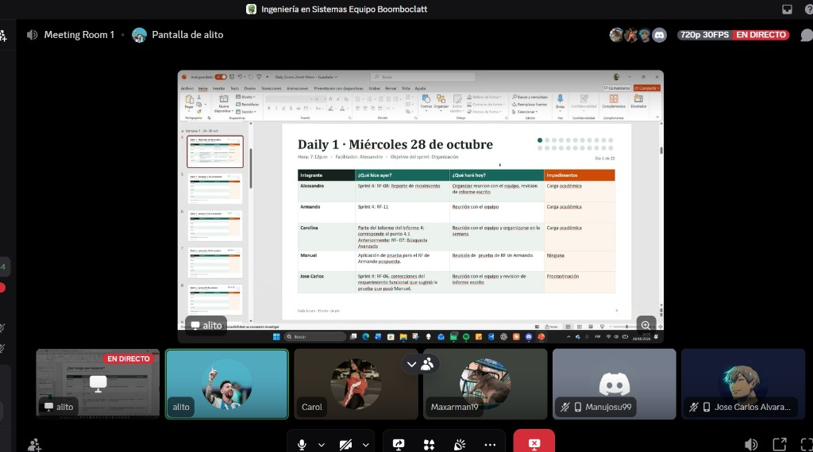
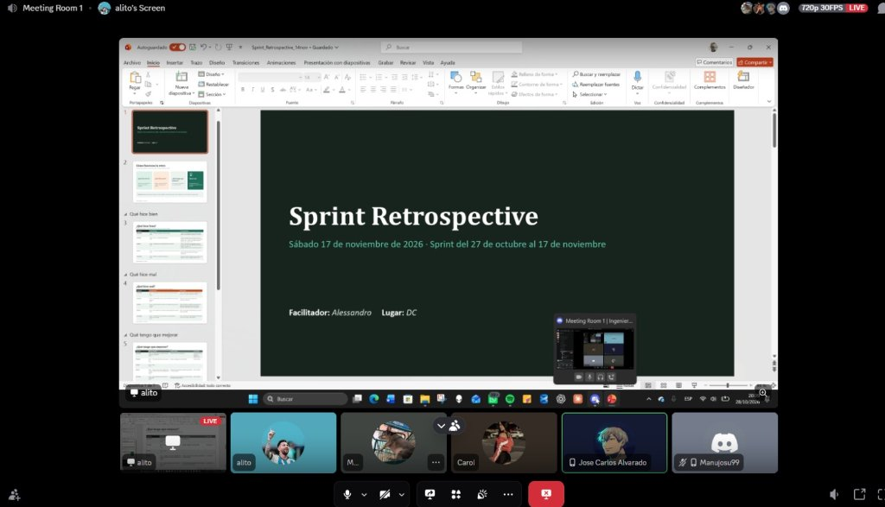
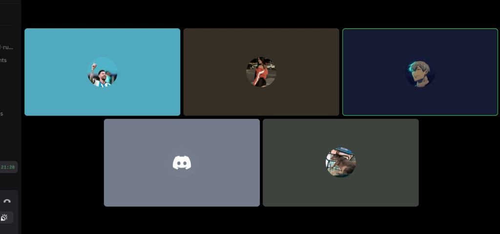
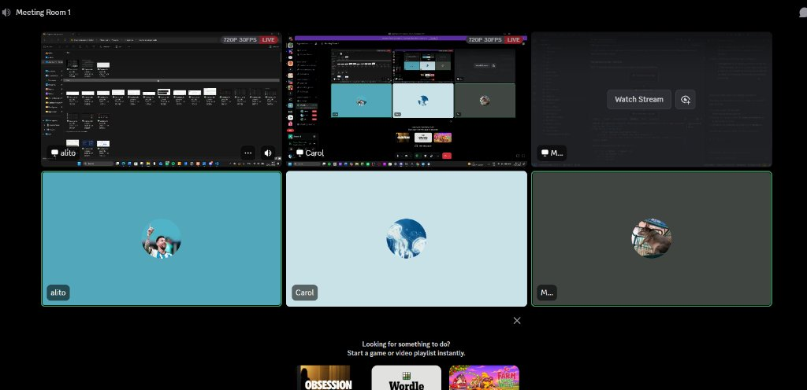
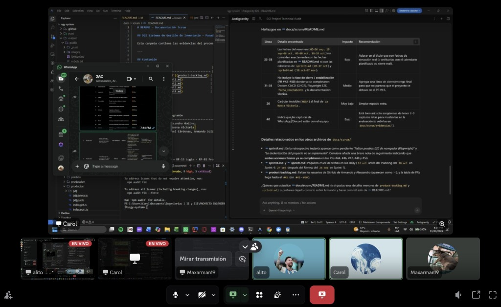
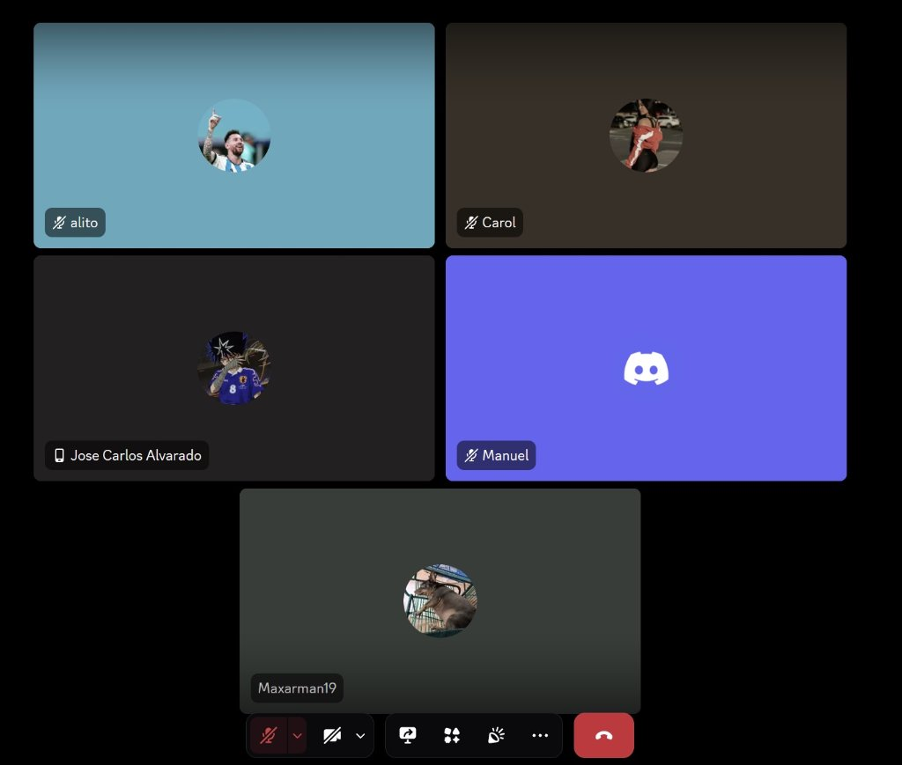
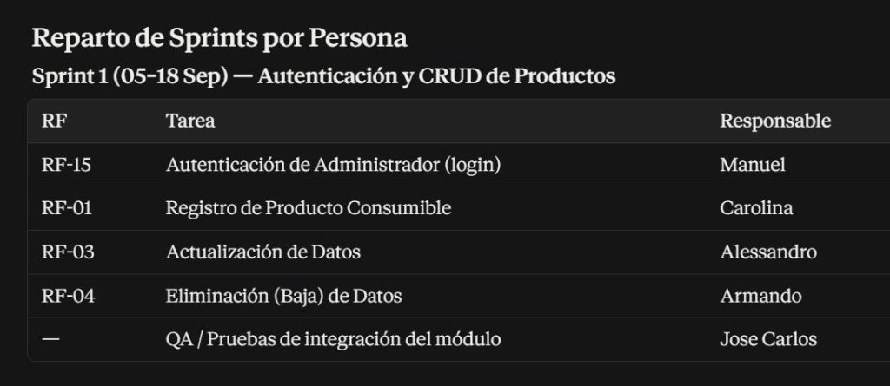
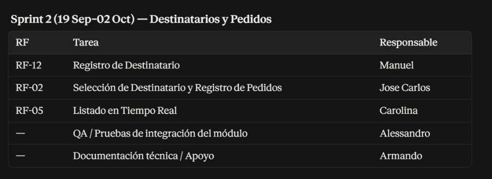
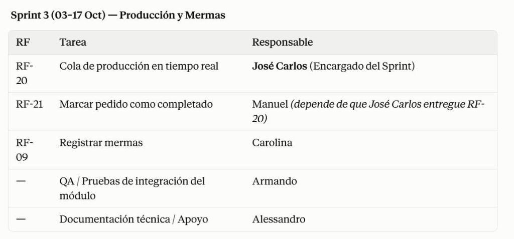
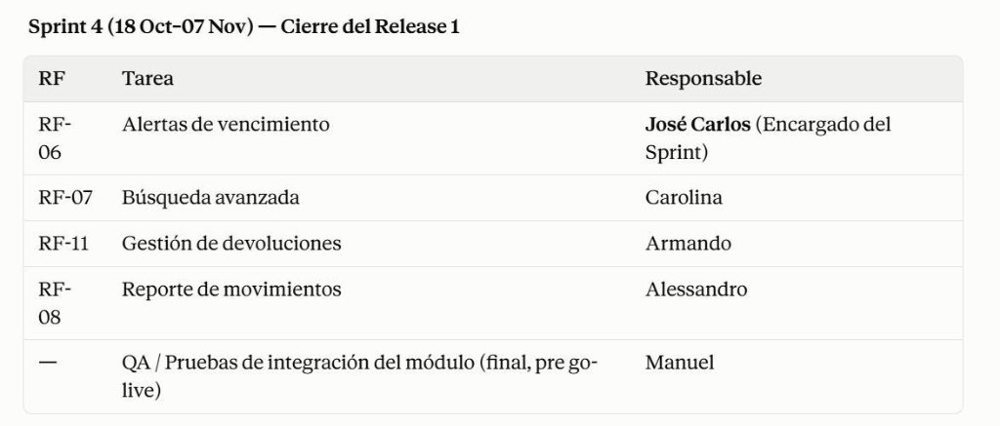

# README — Documentación Scrum

## SGI Sistema de Gestión de Inventario · Panadería La Nueva Victoria

Esta carpeta contiene las evidencias del proceso Scrum aplicado durante el desarrollo del proyecto en Ingeniería en Sistemas II (UNA · Semestre II 2026).

---

## Contenido

| Archivo | Descripción |
| --- | --- |
| [`product-backlog.md`](product-backlog.md) | Product Backlog completo con todas las Historias de Usuario de los 4 sprints |
| [`sprint1.md`](sprint1.md) | Planning, Daily Scrums, Review y Retrospectiva del Sprint 1 (Autenticación + Productos) |
| [`sprint2.md`](sprint2.md) | Planning, Daily Scrums, Review y Retrospectiva del Sprint 2 (Destinatarios + Pedidos) |
| [`sprint3.md`](sprint3.md) | Planning, Daily Scrums, Review y Retrospectiva del Sprint 3 (Producción + Mermas) |
| [`sprint4.md`](sprint4.md) | Planning, Daily Scrums, Review y Retrospectiva del Sprint 4 (Alertas + Búsqueda + Devoluciones + Reportes) |
| [`evidencias/`](evidencias/) | Capturas de ceremonias y reuniones de coordinación del equipo en Discord |

---

## Equipo Scrum

| Rol | Integrante |
| --- | --- |
| Scrum Master | Alessandro Godinez |
| Product Owner | La Nueva Victoria |
| Dev Team | Manuel Cárdenas, Armando Solís, Alessandro Godinez, José Carlos Ordóñez, Carolina Zhou |

---

## Resumen de Sprints (fechas de ejecución y cierre)

```text
Sprint 1 (05–26 sep)       → RF-15 Login · RF-01 Productos · RF-03 Editar · RF-04 Baja
Sprint 2 (19 sep–06 oct)   → RF-12 Destinatarios · RF-02 Pedidos · RF-05 Tiempo Real
Sprint 3 (03–08 oct)       → RF-20 Producción · RF-21 Completar Pedido · RF-09 Mermas
Sprint 4 (18–28 oct)       → RF-06 Alertas · RF-07 Búsqueda · RF-08 Reporte · RF-11 Devoluciones
Cierre   (29 oct–20 nov)   → Docker/Compose · CI/CD (GHCR) · Playwright E2E · Fecha de vencimiento · Documentación
```

---

## Evidencias de Reuniones Scrum (Discord)

### 1. Daily Scrum — Seguimiento del Sprint 4 (28 de octubre)

Sesión facilitada por el Scrum Master (Alessandro) con los 5 integrantes conectados, revisando avances del Sprint 4 (`RF-06`, `RF-07`, `RF-08`, `RF-11`), tareas del día e impedimentos.



### 2. Sprint Retrospective — Cierre de Sprint (facilitador: Alessandro)

Sesión de retrospectiva en Discord con participación del equipo completo analizando qué se hizo bien, qué mejorar y acciones de cierre.



### 3. Reunión de coordinación con el equipo completo

Llamada grupal en Discord con los 5 integrantes del equipo de desarrollo.



### 4. Sesión de trabajo colaborativo y revisión de entregas

Sesión de trabajo compartiendo pantalla en Discord (`Meeting Room 1`) para revisar evidencias y avances del repositorio.



### 5. Revisión final de documentación y auditoría técnica

Sesión de cierre revisando la documentación técnica, evidencias Scrum y estado final del proyecto previo a la presentación.



### 6. Reunión de seguimiento con todos los integrantes

Llamada en Discord con los 5 integrantes identificados (`alito`, `Carol`, `Jose Carlos Alvarado`, `Manuel`, `Maxarman19`).



---

## Evidencias de Planificación (Reparto de Sprints)

### Sprint 1 (05–18 Sep) — Autenticación y CRUD de Productos



### Sprint 2 (19 Sep–02 Oct) — Destinatarios y Pedidos



### Sprint 3 (03–17 Oct) — Producción y Mermas



### Sprint 4 (18 Oct–07 Nov) — Cierre del Release 1


